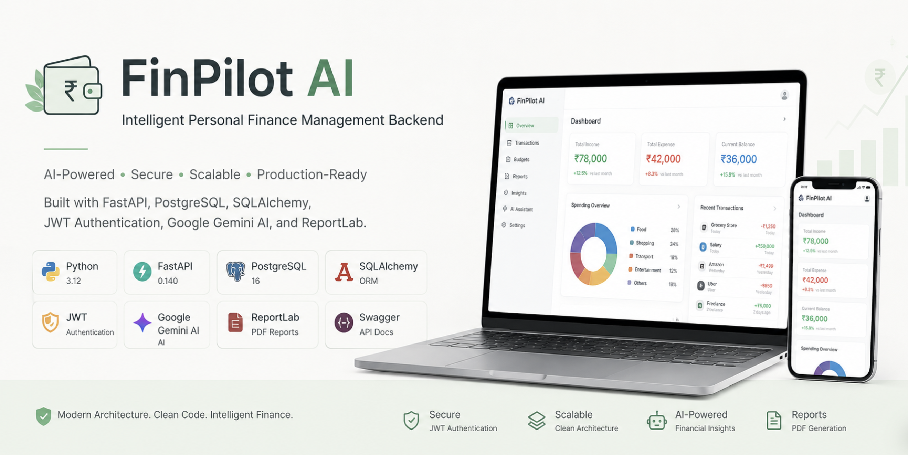
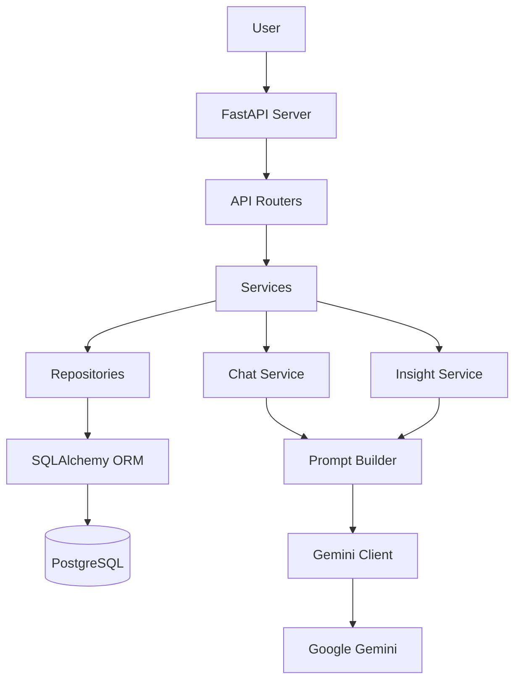
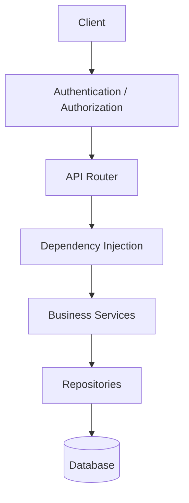
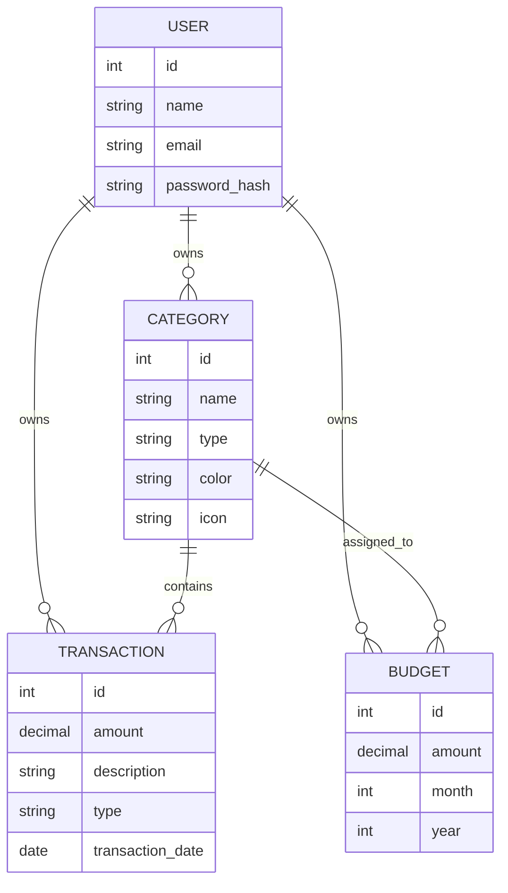
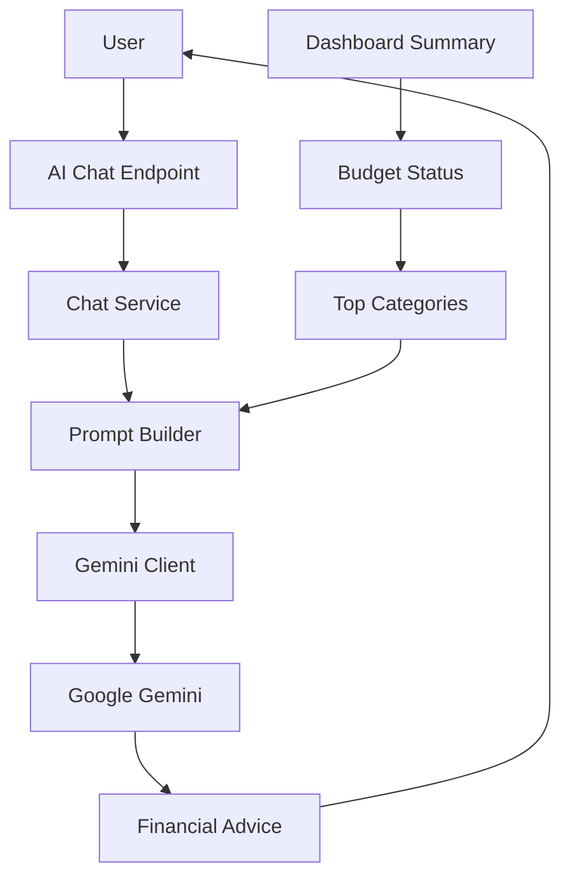
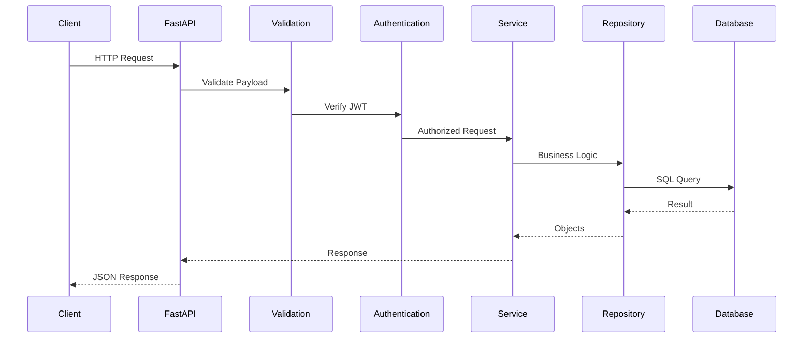
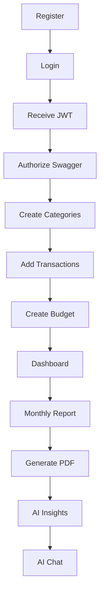
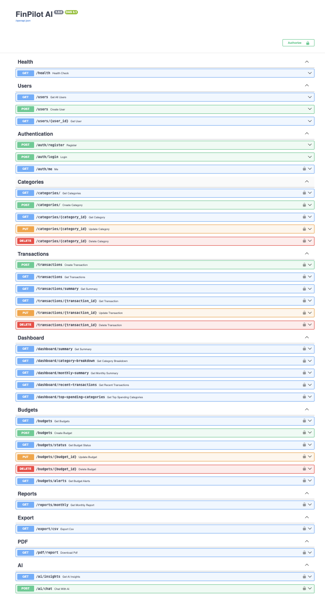

# 💰 FinPilot AI — Intelligent Personal Finance Management Backend

<p align="center">
  
</p>

<p align="center">
  <b>An AI-powered personal finance backend built with FastAPI, PostgreSQL, SQLAlchemy, JWT authentication, and Google Gemini.</b>
  <br>
  Designed as a production-inspired backend system with layered architecture, ownership-aware authorization, automated testing, Docker containerization, database migrations, local Kubernetes deployment, and live cloud deployment.
</p>

<p align="center">
  <a href="https://finance-assistant-1tks.onrender.com"></a>
  <a href="https://finance-assistant-1tks.onrender.com/docs"></a>
  
  
  
  
  
  
  
</p>

---

## 📑 Table of Contents

1. [Project at a Glance](#-project-at-a-glance)
2. [Design Principles](#️-design-principles)
3. [Key Features](#-key-features)
4. [System Architecture](#-system-architecture)
   - [High-Level Architecture](#high-level-architecture)
   - [Backend Architecture](#backend-architecture)
   - [Database Schema](#database-schema)
   - [AI Architecture](#ai-architecture)
   - [Request Lifecycle](#request-lifecycle)
5. [User Flow](#-user-flow)
6. [Project Structure](#-project-structure)
7. [Technology Stack](#️-technology-stack)
8. [Getting Started](#-getting-started)
9. [API Documentation](#-api-documentation)
10. [API Reference](#-api-reference)
11. [Business Rules](#-business-rules)
12. [Security](#-security)
13. [Error Handling](#️-error-handling)
14. [Testing](#-testing)
15. [Deployment](#️-deployment)
    - [Local Kubernetes Deployment (Kind)](#local-kubernetes-deployment-kind)
16. [Roadmap](#-roadmap)
17. [FAQ](#-frequently-asked-questions)
18. [Contributing](#-contributing)
19. [Author](#-author)
20. [License](#-license)

---

## 📌 Project at a Glance

FinPilot AI is a backend-first personal finance platform that lets authenticated users track transactions, manage categories and budgets, generate financial reports, and receive AI-powered financial insights — all through a secured, ownership-aware RESTful API.

| Capability | Status |
|---|---|
| REST API | ✅ Live |
| PostgreSQL | ✅ Connected |
| JWT Authentication | ✅ Implemented |
| Transactions, Categories & Budgets | ✅ Implemented |
| Dashboard Analytics | ✅ Implemented |
| Reports, PDF & CSV Export | ✅ Implemented |
| Gemini AI Insights & Chat | ✅ Implemented |
| Database Migrations (Alembic) | ✅ Implemented |
| Automated Tests | ✅ 72 passing |
| Code Quality (Ruff) | ✅ Configured |
| Docker & Docker Compose | ✅ Implemented |
| Local Kubernetes Deployment (Kind) | ✅ Implemented |
| Cloud Deployment (Render) | ✅ Live |

### 🌐 Live Demo

| Resource | Link |
|----------|------|
| 🚀 Production API | [finance-assistant-1tks.onrender.com](https://finance-assistant-1tks.onrender.com) |
| 📚 Swagger UI | [finance-assistant-1tks.onrender.com/docs](https://finance-assistant-1tks.onrender.com/docs) |
| ❤️ Health Check | [finance-assistant-1tks.onrender.com/health](https://finance-assistant-1tks.onrender.com/health) |

There's no frontend yet — click **Swagger UI** above to explore and test the API endpoints directly.

---

## 🏛️ Design Principles

FinPilot AI follows clean architecture: a repository pattern for database abstraction, a service layer for business logic, dependency injection for loose coupling, Pydantic schemas for request/response validation, SQLAlchemy ORM for persistence, centralized exception handling, JWT-based authorization, modular API routing, and an AI layer isolated from business logic.

This separation keeps components focused on individual responsibilities and improves maintainability, scalability, and testability.

---

## 🚀 Key Features

**🔐 Authentication** — JWT-based authentication, secure registration and login, password hashing, protected endpoints, and ownership validation.

**💰 Finance Management** — Income and expense tracking, custom categories, monthly budgets with alerts, financial reports, and monthly summaries.

**🤖 Artificial Intelligence** — AI-generated financial insights, conversational chat assistance, personalized recommendations, and spending analysis powered by Google Gemini.

**📄 Reports & Dashboard** — Monthly reports, downloadable PDF and CSV exports, income-versus-expense breakdowns, budget utilization, and top spending categories.

**🐳 Containerization** — Docker-based application packaging and Docker Compose support for local development.

**☸️ Local Kubernetes** — A Kind-based local Kubernetes environment with FastAPI and PostgreSQL deployments, persistent database storage, ConfigMaps, Secrets, Services, health probes, and an Alembic migration Job.

---

## 🏗️ System Architecture

FinPilot AI follows a layered architecture that separates responsibilities across independent modules using the Repository-Service Pattern.

| Layer | Responsibility |
|-------|-----------------|
| API Layer | Handles HTTP requests and responses |
| Service Layer | Contains business logic |
| Repository Layer | Interacts with the database |
| Model Layer | Defines database entities |
| Schema Layer | Validates request and response data |
| AI Layer | Integrates with Google Gemini |
| Database Layer | Stores persistent financial data |

### High-Level Architecture



### Backend Architecture



### Database Schema

PostgreSQL stores the application's relational data. The main entities are Users, Categories, Transactions, and Budgets, with relationships enforced through foreign keys.



### AI Architecture

The AI module is isolated from the rest of the application. AI requests flow through dedicated services instead of accessing Gemini directly, making it easier to change models or introduce retrieval-augmented generation in the future.



> **Illustrative example:** Actual responses vary by user and Gemini output. A question such as "Where am I spending the most?" can be answered using summarized spending information to identify major categories and potential areas for savings.

### Request Lifecycle



---

## 🧭 User Flow



---

## 📂 Project Structure

```text
finance_assistant
│
├── app
│   ├── ai                  # Gemini client and prompt builder
│   ├── api                 # Routers (health, root, v1/*)
│   ├── auth                # JWT and password hashing
│   ├── core                # App factory, settings, logging
│   ├── database            # SQLAlchemy session and base
│   ├── dependencies        # Dependency injection, pagination, sorting
│   ├── enums               # Category, transaction, and budget enums
│   ├── exceptions          # Domain exceptions
│   ├── models              # SQLAlchemy models
│   ├── repositories        # Data access layer
│   ├── schemas             # Pydantic request/response models
│   ├── services            # Business logic
│   └── main.py
│
├── alembic                 # Database migrations
├── docker                  # docker-compose.yml
├── docs                    # Banner and documentation images
├── k8s
│   └── local
│       ├── api.yaml
│       ├── configmap.yaml
│       ├── migrations-job.yaml
│       ├── namespace.yaml
│       ├── postgres.yaml
│       ├── secret.example.yaml
│       └── services.yaml
├── tests                   # Pytest suite
├── Dockerfile
├── alembic.ini
├── pytest.ini
├── runtime.txt
├── .env.example
├── pyproject.toml
└── README.md
```

---

## ⚙️ Technology Stack

| Component | Technology |
|-----------|------------|
| Language | Python 3.12 |
| Framework | FastAPI |
| ASGI Server | Uvicorn |
| ORM | SQLAlchemy 2.x |
| Database | PostgreSQL |
| Migrations | Alembic |
| Validation | Pydantic v2 |
| Authentication | JWT (python-jose) |
| Password Hashing | pwdlib (Argon2) |
| AI | Google Gemini (google-genai SDK) |
| PDF Generation | ReportLab |
| Logging | Loguru |
| API Documentation | Swagger UI / ReDoc |
| Package Manager | uv |
| Containerization | Docker and Docker Compose |
| Orchestration | Kubernetes with Kind (local development) |
| Testing | pytest |
| Linting | Ruff |

---

## 🚀 Getting Started

### Prerequisites

| Software | Notes |
|-----------|---------|
| Python | 3.12+ |
| PostgreSQL | Required, unless using Docker Compose |
| uv | Python package manager |
| Google Gemini API key | Required for AI features |

### Clone & Install

```bash
git clone https://github.com/antrika02/finance_assistant.git
cd finance_assistant
uv sync
```

### Configure Environment

Create your local environment file:

```bash
cp .env.example .env
```

Configure the values in `.env`:

```env
APP_NAME=FinPilot AI
DEBUG=True
HOST=127.0.0.1
PORT=8000

SECRET_KEY=replace_with_a_random_secret
ALGORITHM=HS256
ACCESS_TOKEN_EXPIRE_MINUTES=30

DATABASE_HOST=localhost
DATABASE_PORT=5432
DATABASE_NAME=personal_finance
DATABASE_USER=postgres
DATABASE_PASSWORD=replace_with_a_local_password

GEMINI_API_KEY=replace_with_your_google_gemini_api_key
GEMINI_MODEL=gemini-2.5-flash
```

Generate a random application secret with:

```bash
openssl rand -hex 32
```

Replace the example values with your own credentials. These settings are for local development only; do not use example credentials in production.

### Run Migrations & Start the Server

Ensure PostgreSQL is running and the database exists. Then run:

```bash
uv run alembic upgrade head
uv run uvicorn app.main:app --reload
```

The server runs at `http://127.0.0.1:8000`.

### 🐳 Run with Docker (Alternative)

From the repository root:

```bash
docker compose -f docker/docker-compose.yml up --build
```

In another terminal, run the migrations:

```bash
docker compose -f docker/docker-compose.yml exec api uv run alembic upgrade head
```

The Compose configuration starts the API, PostgreSQL, and pgAdmin. The API is available at `http://localhost:8000`, and pgAdmin is available at `http://localhost:5050`, subject to the ports configured in the Compose file.

---

## 🌐 API Documentation

| Docs | URL |
|------|-----|
| Live Swagger UI | [finance-assistant-1tks.onrender.com/docs](https://finance-assistant-1tks.onrender.com/docs) |
| Local Swagger UI | `http://127.0.0.1:8000/docs` |
| Local ReDoc | `http://127.0.0.1:8000/redoc` |

From Swagger, register or log in, obtain a JWT, click **Authorize**, and test the protected endpoints interactively.

<p align="center">
  
</p>

---

## 📚 API Reference

All endpoints are RESTful and return JSON unless an endpoint provides a downloadable file.

### 🔐 Authentication

| Method | Endpoint | Protected |
|---------|----------|-----------|
| POST | `/auth/register` | ❌ |
| POST | `/auth/login` | ❌ |
| GET | `/auth/me` | ✅ |

`/auth/login` uses the OAuth2 password flow (`application/x-www-form-urlencoded` with `username` and `password` fields). Swagger's **Authorize** button submits this format automatically.

### 📂 Categories

| Method | Endpoint |
|---------|----------|
| POST / GET | `/categories/` |
| GET / PUT / DELETE | `/categories/{id}` |

### 💳 Transactions

| Method | Endpoint |
|---------|----------|
| POST / GET | `/transactions` |
| GET / PUT / DELETE | `/transactions/{id}` |
| GET | `/transactions/summary` |

Supports filtering by `type`, `category_id`, `start_date`, `end_date`, and `search`, with pagination and sorting via `page`, `size`, and `sort`.

### 📊 Dashboard

| Method | Endpoint |
|---------|----------|
| GET | `/dashboard/summary` |
| GET | `/dashboard/category-breakdown` |
| GET | `/dashboard/monthly-summary` |
| GET | `/dashboard/recent-transactions` |
| GET | `/dashboard/top-spending-categories` |

### 💰 Budgets

| Method | Endpoint |
|---------|----------|
| POST / GET | `/budgets` |
| PUT / DELETE | `/budgets/{id}` |
| GET | `/budgets/status`, `/budgets/alerts` |

Budget status thresholds: **Healthy** below 80%, **Warning** from 80% to below 100%, and **Exceeded** at 100% or more.

### 📄 Reports, Export & AI

| Method | Endpoint | Description |
|---------|----------|-------------|
| GET | `/reports/monthly` | Monthly financial report |
| GET | `/export/csv` | Downloadable CSV of transactions |
| GET | `/pdf/report` | Downloadable PDF financial report |
| GET | `/ai/insights` | AI-generated financial insights |
| POST | `/ai/chat` | Conversational financial assistant |

### Example

```json
{
  "message": "How can I reduce my monthly expenses?"
}
```

Send this payload to `POST /ai/chat`.

The response structure depends on the endpoint's response schema and the generated AI output.

---

## ✅ Business Rules

- Categories, transactions, and budgets belong to individual users.
- Cross-user access is blocked by ownership validation.
- Only one budget is allowed per category per month.
- Dashboard statistics are computed from the authenticated user's data.
- Protected endpoints require a valid JWT.
- Unauthorized requests return `401`; forbidden cross-user access returns `403` where applicable.

---

## 🔒 Security

Passwords are hashed using Argon2 through pwdlib and are never stored in plaintext. Protected routes require JWT authentication, and ownership validation is performed before user-owned resources are accessed.

The AI layer uses dedicated services to assemble summarized financial context before calling Gemini. This helps limit the information sent to the model.

Sensitive configuration, including database credentials, secret keys, and the Gemini API key, belongs in environment variables or an appropriate secrets manager.

The `.env` file must not be committed to Git.

### Development and production configuration

The example settings in the Getting Started section are intended for local development only.

For production:

- Use a strong, unique application secret.
- Configure an explicit production database URL.
- Set `DEBUG=False`.
- Restrict CORS to trusted origins.
- Store credentials in a secure secrets manager or platform-provided secret configuration.
- Never commit real credentials or Kubernetes Secret manifests containing actual values.

The local Kubernetes deployment uses a Kubernetes Secret for configuration, but Kubernetes Secrets are not automatically equivalent to an encrypted external secrets manager. Treat this setup as local development infrastructure, not as a complete production security configuration.

---

## ⚠️ Error Handling

| Status | Meaning |
|---------|----------|
| 400 | Invalid Request |
| 401 | Unauthorized |
| 403 | Forbidden |
| 404 | Not Found |
| 409 | Conflict |
| 422 | Validation Error |
| 500 | Internal Server Error |

Example:

```json
{
  "detail": "Transaction not found."
}
```

---

## 🧪 Testing

FinPilot AI includes a pytest suite covering API endpoints, authentication, business logic, database interactions, AI services, validation, authorization, and error handling. Ruff is used for code quality checks.

Run the tests with:

```bash
uv run pytest
```

Run Ruff checks with:

```bash
uv run ruff check .
```

Previously recorded test result:

```text
72 passed, 1 warning in 5.08s
```

Test results can vary with subsequent code changes and environment configuration.

---

## ☁️ Deployment

FinPilot AI is deployed as a FastAPI service on Render, with a managed Neon PostgreSQL database configured separately from the local Docker and Kubernetes databases.

The Python runtime is pinned through `runtime.txt`, and `requirements.txt` is exported from `uv.lock` for the Render build.

**Production API:** https://finance-assistant-1tks.onrender.com

Previously verified health checks:

```text
GET /       → 200 OK
GET /health → healthy, database: connected
HEAD /docs  → 200 OK
```

The application can also be deployed to platforms supporting ASGI applications, subject to their configuration and infrastructure requirements.

For local containerized deployment, see [Run with Docker](#-run-with-docker-alternative).

---

## Local Kubernetes Deployment (Kind)

FinPilot AI can run locally on Kubernetes using Docker Desktop and Kind.

**Environment:** Local development and learning. This is not an AWS, managed Kubernetes, or production cloud deployment.

### Architecture

```text
Developer Machine
└── Docker Desktop
    └── Kind Cluster: finpilot-local
        └── Namespace: finpilot
            ├── FastAPI Deployment
            │   └── ClusterIP Service
            ├── PostgreSQL Deployment
            │   ├── ClusterIP Service
            │   └── PersistentVolumeClaim (1 GiB)
            ├── ConfigMap
            ├── Kubernetes Secret
            └── Alembic Migration Job
```

### Prerequisites

Install and start Docker Desktop. Install Docker, kubectl, and Kind.

Verify the tools:

```bash
docker --version
kubectl version --client
kind version
```

### Start or reuse the local cluster

Check whether the cluster already exists:

```bash
kind get clusters
```

If `finpilot-local` already exists, reuse it. Otherwise, create it:

```bash
kind create cluster --name finpilot-local
```

Verify the cluster:

```bash
kubectl cluster-info --context kind-finpilot-local
kubectl get nodes
```

### Build and load the API image

Run these commands from the repository root:

```bash
docker build -t finpilot-api:local .
kind load docker-image finpilot-api:local --name finpilot-local
```

Repeat these commands after changing application code so that the cluster has the updated image.

### Configure Kubernetes resources

Apply the namespace and ConfigMap:

```bash
kubectl apply -f k8s/local/namespace.yaml
kubectl apply -f k8s/local/configmap.yaml
```

### Create the Kubernetes Secret

The application requires these three Secret values:

- `DATABASE_PASSWORD`
- `SECRET_KEY`
- `GEMINI_API_KEY`

For a new local deployment, first choose a database password and a random application secret. Use the same database password when initializing PostgreSQL and when configuring the application.

The following example prompts for the values without displaying them:

```bash
read -s "DB_PASSWORD?Enter a local PostgreSQL password: "
echo
read -s "APP_SECRET?Enter a random application secret key: "
echo
read -s "GEMINI_KEY?Enter your Gemini API key: "
echo

if [ -z "$DB_PASSWORD" ] || [ -z "$APP_SECRET" ] || [ -z "$GEMINI_KEY" ]; then
  echo "Error: all three values are required."
else
  kubectl create secret generic finpilot-secrets \
    --namespace finpilot \
    --from-literal="DATABASE_PASSWORD=$DB_PASSWORD" \
    --from-literal="SECRET_KEY=$APP_SECRET" \
    --from-literal="GEMINI_API_KEY=$GEMINI_KEY"
fi

unset DB_PASSWORD APP_SECRET GEMINI_KEY
```

Use a random application secret of at least 32 characters.

**Important:** This command creates the Secret and will report an error if a Secret with the same name already exists. For an existing environment, preserve the existing Secret unless you intentionally need to rotate credentials.

The PostgreSQL container uses its configured password when initializing an empty database directory. Changing `DATABASE_PASSWORD` in the Kubernetes Secret alone does not change the password of a database that has already been initialized.

For an initialized local environment, use the same password already configured for PostgreSQL. For a completely fresh environment, ensure the database password is consistent from initialization onward.

The file `k8s/local/secret.example.yaml` contains placeholders only. Do not apply it as a real Secret, and never commit actual credentials.

### Deploy PostgreSQL

Apply the PostgreSQL resources and wait for the Deployment:

```bash
kubectl apply -f k8s/local/postgres.yaml
kubectl rollout status deployment/postgres -n finpilot --timeout=180s
kubectl apply -f k8s/local/services.yaml
```

Check database readiness:

```bash
kubectl exec -n finpilot deployment/postgres -- pg_isready -U finpilot -d personal_finance
```

Expected output indicates that PostgreSQL is accepting connections.

### Run database migrations

For the first deployment, create and wait for the migration Job:

```bash
kubectl apply -f k8s/local/migrations-job.yaml

kubectl wait \
  --for=condition=complete \
  job/finpilot-migrations \
  -n finpilot \
  --timeout=180s

kubectl logs job/finpilot-migrations -n finpilot
```

If the Job fails, inspect its logs before proceeding.

For a subsequent migration run, the previous completed Job must be replaced before it can run again:

```bash
kubectl delete job finpilot-migrations -n finpilot --ignore-not-found

kubectl apply -f k8s/local/migrations-job.yaml

kubectl wait \
  --for=condition=complete \
  job/finpilot-migrations \
  -n finpilot \
  --timeout=180s
```

Do not delete the PostgreSQL persistent volume simply to rerun migrations. Alembic manages schema changes; the database data should remain intact.

### Deploy and verify the API

Apply the API Deployment:

```bash
kubectl apply -f k8s/local/api.yaml
kubectl rollout status deployment/finpilot-api -n finpilot --timeout=180s
```

Inspect the resources:

```bash
kubectl get pods,services,deployments -n finpilot
```

All application containers should become ready.

### Access the API

Forward the local port:

```bash
kubectl port-forward -n finpilot service/finpilot-api 8000:8000
```

Keep this command running in its terminal.

Access the application at:

| Resource | URL |
|----------|-----|
| Swagger UI | http://localhost:8000/docs |
| ReDoc | http://localhost:8000/redoc |
| Health check | http://localhost:8000/health |

Verify the API from another terminal:

```bash
curl -i http://localhost:8000/health
```

A healthy response returns HTTP 200 and indicates that the database is connected.

If port 8000 is already occupied, use another local port:

```bash
kubectl port-forward -n finpilot service/finpilot-api 8001:8000
```

The API will then be accessible at `http://localhost:8001/docs`.

### Troubleshooting

Check Pod status:

```bash
kubectl get pods -n finpilot
```

Inspect recent events:

```bash
kubectl get events -n finpilot --sort-by=.lastTimestamp
```

Inspect API logs:

```bash
kubectl logs deployment/finpilot-api -n finpilot --tail=100
```

Inspect migration logs:

```bash
kubectl logs job/finpilot-migrations -n finpilot
```

Check the PostgreSQL connection:

```bash
kubectl exec -n finpilot deployment/postgres -- pg_isready -U finpilot -d personal_finance
```

After changing application code, rebuild the Docker image and load it into Kind again. If the database schema changes, run the appropriate migrations before deploying code that depends on the new schema.

### Remove the local environment

Stop port forwarding with `Ctrl+C`.

To delete the local Kind cluster:

```bash
kind delete cluster --name finpilot-local
```

**Warning:** Deleting the cluster removes its local resources and database storage. Any data stored in the local database may be lost. This command does not delete the repository or its files.

---

## 🗺 Roadmap

**✅ Completed**

User Authentication · Categories, Transactions & Budgets CRUD · Dashboard Analytics · Reports, PDF & CSV Export · AI Insights & AI Chat · Exception Handling · Swagger Documentation · Alembic Database Migrations · Docker & Docker Compose · Local Kubernetes Deployment (Kind) · Automated pytest Suite · Ruff Code Quality Checks · Render Deployment with Neon PostgreSQL

**🚧 Planned**

GitHub Actions CI/CD · Email Reports · Multi-Currency Support · Expense Forecasting · OCR Receipt Scanner · Investment Portfolio Tracking · Savings Goals · Notification System · Banking API Integration

**🌱 Future Scope**

Retrieval-Augmented Generation (RAG) · Voice-Based Financial Assistant · Cash Flow Forecasting · Financial Health Score · Redis Caching · Celery Background Tasks · Prometheus/Grafana Observability

---

## ❓ Frequently Asked Questions

**Why these technologies?**

FastAPI provides automatic API documentation and a modern Python API framework. PostgreSQL supports relational integrity for financial data. SQLAlchemy and the Repository-Service Pattern separate data access from business logic. Google Gemini powers the AI features and can be replaced with another model through an appropriately designed integration layer.

**Does this repository contain a frontend?**

No. FinPilot AI is currently a backend project. The API can be explored using Swagger UI.

**Is the Kubernetes deployment production-ready?**

The included Kind configuration is designed for local development and learning. A production Kubernetes deployment would require additional work around secrets management, networking, TLS, monitoring, resource sizing, backups, high availability, and operational security.

---

## 🤝 Contributing

Contributions are welcome. Fork the repository and submit a pull request.

```bash
git clone https://github.com/antrika02/finance_assistant.git
cd finance_assistant
git checkout -b feature/your-feature-name

# Make your changes

git commit -m "feat: add your feature"
git push origin feature/your-feature-name
```

Follow the existing project structure, use type hints, keep services independent, and run tests before submitting changes.

Commit conventions:

- `feat:` — New feature
- `fix:` — Bug fix
- `refactor:` — Code restructuring
- `docs:` — Documentation
- `style:` — Formatting
- `test:` — Tests
- `chore:` — Maintenance

---

## 👩‍💻 Author

**Antrika Kashyap**

Backend Developer | AI Engineer

| Platform | Link |
|----------|------|
| GitHub | [github.com/antrika02](https://github.com/antrika02) |
| LinkedIn | [linkedin.com/in/antrika-kashyap-070502250](https://www.linkedin.com/in/antrika-kashyap-070502250/) |
| Email | antrikakashyap2@gmail.com |

If you found this project useful, consider giving it a ⭐ on GitHub.

---

## 📄 License

Licensed under the MIT License.

---

<p align="center">
  ⭐ Built with FastAPI, PostgreSQL, SQLAlchemy, and Google Gemini AI.
</p>